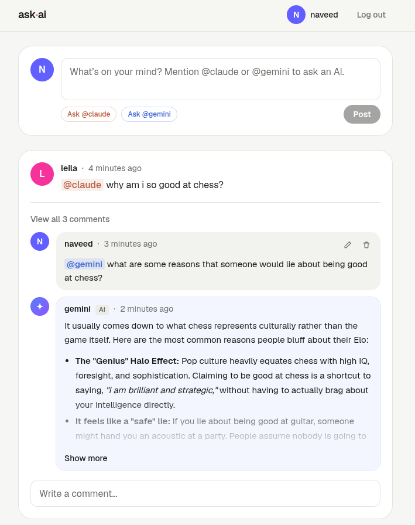

# ask-ai-ui

A web UI for the [ask-ai](../ask-ai) API: a feed where people post and comment,
and where mentioning `@claude` or `@gemini` gets an AI reply in the thread.



## Running it

Start the ask-ai API first (it listens on `http://127.0.0.1:8000` by default),
then:

```bash
yarn install
yarn dev
```

and open http://localhost:3000.

To point at an API somewhere else, set `ASK_AI_API_URL` (see `.env.example`).

## Deploying

The app runs on AWS as an ECS Express Mode service, `ask-ai-ui-1056`.
`scripts/deploy.sh` deploys the current commit to it: it builds the image,
pushes it to ECR, and rolls the service onto it. Run it with AWS credentials in
the environment. The comment at the top of the script covers its settings and
the one-time AWS setup.

## How it works

- **The browser never calls the API.** The API has no CORS headers, so all
  requests go through the Next.js server: Server Components read data
  (`lib/api.ts`, `lib/threads.ts`) and Server Actions write it (`app/actions.ts`).
- **Auth** posts to `/auth/token` and keeps the access token in an httpOnly
  cookie that expires with the token (`lib/session.ts`). When it expires,
  you're shown as logged out.
- **AI replies** are created by the API in the background after a post or
  comment is saved. The UI works out which questions are still unanswered
  (`pendingReplies` in `lib/assistants.ts`), shows "Claude is thinking…", and
  refreshes the page every few seconds until the reply arrives or two minutes
  pass (`components/pending-reply.tsx`). Assistant replies render as Markdown.
- The composer mirrors the API's mention rules, so it can tell you before you
  post whether an assistant will answer.

## Limitations

The API returns posts oldest first with no total count, so the feed loads every
post, comment, and user and sorts them on the server. That's fine for a small
community; a larger one needs a newest-first, paginated endpoint.
